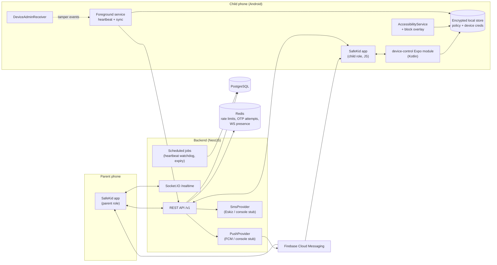
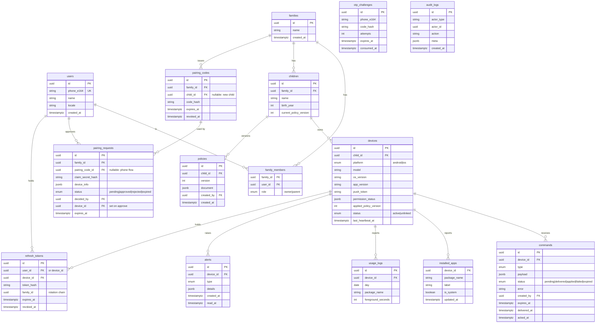
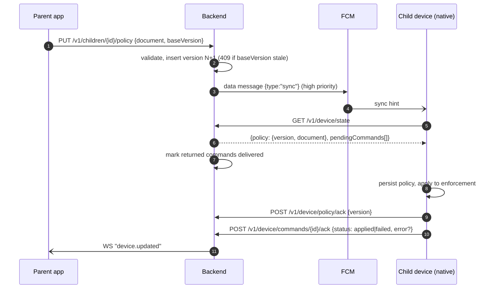

# SafeKid — Architecture

Status: draft for Phase 1. Sections marked _(later)_ are designed for but not built in Phase 1.

## 1. System overview



Key principles:

- **Server is the source of truth**, device is the enforcer. The device always enforces the last policy it applied, online or offline.
- **Push is a hint, not a transport.** FCM/WebSocket messages only say "something changed — sync". The device then pulls state over authenticated REST. Lost pushes are recovered by heartbeat-time sync.
- **Two kinds of identity**: parent users (phone + OTP) and child devices (device credentials issued only after parent approval).

## 2. Identity & auth

| Principal    | How it signs in                | Token audience | Notes                                                                                                                                          |
| ------------ | ------------------------------ | -------------- | ---------------------------------------------------------------------------------------------------------------------------------------------- |
| Parent user  | Phone + SMS OTP                | `user`         | Access JWT 15 min, refresh token 30 days, rotated on every use, reuse detection revokes the whole token family.                                |
| Child device | Pairing flow + parent approval | `device`       | Device access JWT 15 min + device refresh token (long-lived, rotated). Stored in encrypted storage so native services can use them without JS. |

- OTP: 6 digits, stored as HMAC hash, TTL 5 min, max 5 verification attempts, resend cooldown 60 s, per-phone and per-IP limits in Redis (e.g. 5 requests / hour / phone, 20 / hour / IP).
- Phone numbers normalized to E.164 (`libphonenumber-js`).
- Guards: `UserAuthGuard`, `DeviceAuthGuard`, and resource guards (`FamilyMemberGuard`, `ChildAccessGuard`, `DeviceAccessGuard`) that load the resource and verify the caller's family membership.

## 3. Data model

Improvements over the starting draft:

- Child is a **profile** inside a family (`children`), not necessarily a user with a phone. Devices belong to a child. A child can have several devices.
- Pairing is split into **codes** (what the parent shows) and **requests** (what a child device submits and the parent approves).
- Policies are **append-only versions** per child; `children.current_policy_version` points at the active one. Devices report `applied_policy_version`.
- Separate `installed_apps` table (latest snapshot per device), `refresh_tokens`, `otp_challenges`, and `audit_logs`.



### Policy document (versioned JSON, zod schema in `packages/shared`)

```ts
type PolicyDocument = {
  schemaVersion: 1;
  mode: 'unrestricted' | 'allowlist';
  allowedApps: string[]; // app identifiers (Android package names; iOS tokens later)
  alwaysAllowedApps: string[]; // phone, SMS, SafeKid itself — cannot be blocked
  lock: { state: 'unlocked' } | { state: 'locked'; until?: string /* ISO */ };
  schedules: Array<{ id: string; days: Weekday[]; start: 'HH:mm'; end: 'HH:mm'; action: 'lock' }>; // later
  appLimits: Array<{ app: string; dailyMinutes: number }>; // later
  tempUnlock?: { until: string }; // later
  web?: { blockedDomains: string[] }; // later
  timezone: string; // IANA, evaluated on device
};
```

Lock/unlock lives **in the policy** (durable, enforced offline, survives reboots). "Lock now" from the parent creates a new policy version and triggers a sync; it is not a fire-and-forget command.

## 4. Pairing flow (parent approval required)

```mermaid
sequenceDiagram
  autonumber
  participant P as Parent app
  participant B as Backend
  participant C as Child app
  P->>B: POST /v1/families/{id}/pairing-codes {childId? | childName}
  B-->>P: {code: "482913", qrPayload, expiresAt (+10 min)}
  Note over P: shows 6-digit code + QR
  C->>B: POST /v1/pairing/requests {code | parentPhone, deviceInfo}
  Note over B: rate-limited per IP/device; code checked by hash;<br/>phone flow never reveals whether phone exists
  B-->>C: {requestId, claimSecret} (status=pending)
  B-)P: push + WS "pairing.requested"
  P->>B: GET /v1/pairing/requests?status=pending
  P->>B: POST /v1/pairing/requests/{id}/approve {childId}
  B->>B: create device, mark request approved, revoke code
  B-)C: WS/poll "pairing.approved"
  C->>B: POST /v1/pairing/requests/{id}/claim {claimSecret}
  B-->>C: {deviceId, accessToken, refreshToken, policy}
  Note over C: stores creds in encrypted native store,<br/>starts permissions wizard
```

- Code: 6 digits, single family, 10 min TTL, single successful pairing, max 5 wrong attempts per request source.
- Without approval, `claim` returns `403 PAIRING_NOT_APPROVED`. Rejected or expired requests can never be claimed.

## 5. Command & policy sync flow



- Commands are for **one-off actions**: `SYNC_NOW`, `REPORT_APPS`, `REFRESH_PERMISSIONS`, later `RING`, etc. Each has `expires_at`; unacked expired commands become `expired`.
- Fallbacks if FCM is delayed: device syncs on every heartbeat (15 min) and on app/service start. Heartbeat response includes `latestPolicyVersion` and `hasPendingCommands`.
- In dev, `ConsolePushProvider` logs messages; devices also hold a WebSocket while the app is foregrounded.

## 6. Heartbeat & tamper detection

- Device sends `POST /v1/device/heartbeat` every 15 min (foreground service + WorkManager backup) with `appliedPolicyVersion`, `permissionStatus`, battery level, app version.
- Backend watchdog job: no heartbeat > 45 min → alert `HEARTBEAT_LOST`.
- Device-reported alerts: `PERMISSION_REVOKED` (accessibility/usage/admin/overlay turned off), `DEVICE_ADMIN_DISABLE_REQUESTED`, `TIME_CHANGED`, `SAFE_MODE_SUSPECTED` (later).
- App removal: inferred from heartbeat loss + FCM token becoming invalid → `APP_REMOVED_SUSPECTED`.
- All alerts are pushed to parents and recorded in `audit_logs`.

## 7. Android enforcement (no Device Owner)

| Component                      | Purpose                                                                                                                                                                                                                                        |
| ------------------------------ | ---------------------------------------------------------------------------------------------------------------------------------------------------------------------------------------------------------------------------------------------- |
| `AccessibilityService`         | Detects foreground app (`TYPE_WINDOW_STATE_CHANGED`), evaluates the local policy, shows the block overlay (`TYPE_ACCESSIBILITY_OVERLAY`, no extra overlay permission needed). Also protects Settings pages that would disable SafeKid (later). |
| Block screen                   | Native overlay with "Request access" (later) and "Go home" actions.                                                                                                                                                                            |
| `UsageStatsManager`            | Usage stats (Phase 1: permission only; reporting later).                                                                                                                                                                                       |
| `DeviceAdminReceiver`          | Uninstall protection; `onDisableRequested` warns child and raises a tamper alert.                                                                                                                                                              |
| Foreground service             | Keeps process alive, runs heartbeat/sync natively using stored device creds.                                                                                                                                                                   |
| Battery optimization exemption | Requested via wizard (`REQUEST_IGNORE_BATTERY_OPTIMIZATIONS` intent).                                                                                                                                                                          |
| `VpnService` DNS filter        | Website blocking _(later)_.                                                                                                                                                                                                                    |
| `BOOT_COMPLETED` receiver      | Restarts the service after reboot.                                                                                                                                                                                                             |

Policy evaluation is pure Kotlin (`PolicyEvaluator`) with unit tests, independent of Android framework classes.

### Platform-agnostic TS interface (`modules/device-control`)

```ts
interface DeviceControl {
  getCapabilities(): Promise<Capabilities>; // what this platform/OS supports
  getPermissionStatus(): Promise<PermissionStatus>; // per permission: granted | denied | unavailable
  requestPermission(p: PermissionKind): Promise<void>; // opens system flow
  setDeviceCredentials(c: DeviceCredentials): Promise<void>;
  clearDeviceCredentials(): Promise<void>;
  applyPolicy(policy: { version: number; document: PolicyDocument }): Promise<void>;
  getAppliedPolicyVersion(): Promise<number | null>;
  getInstalledApps(): Promise<InstalledApp[]>; // iOS later: FamilyActivityPicker selection
  startEnforcement(): Promise<void>;
  addListener(e: 'permissionChanged' | 'tamper', cb): Subscription;
}
type PermissionKind =
  | 'accessibility'
  | 'usageAccess'
  | 'deviceAdmin'
  | 'notifications'
  | 'batteryOptimization'
  | 'familyControls' /* iOS */;
```

## 8. iOS _(later)_

FamilyControls authorization (`.individual` on child device or `.child` with Family Sharing), ManagedSettings shields, DeviceActivity monitor extension for schedules/limits, ShieldConfiguration extension for the block screen. App identifiers on iOS are opaque tokens, which is why `allowedApps` stays a list of opaque strings and the picker is platform-specific.

## 9. API (Phase 1)

All under `/v1`. 🔒U = user JWT, 🔒D = device JWT.

**Auth**

| Method    | Path                | Auth  |                                                              |
| --------- | ------------------- | ----- | ------------------------------------------------------------ |
| POST      | `/auth/otp/request` | —     | `{phone}` → sends OTP (rate limited)                         |
| POST      | `/auth/otp/verify`  | —     | `{phone, code}` → `{accessToken, refreshToken, user, isNew}` |
| POST      | `/auth/refresh`     | —     | rotate refresh token (user or device)                        |
| POST      | `/auth/logout`      | 🔒U/D | revoke refresh token                                         |
| GET/PATCH | `/me`               | 🔒U   | profile                                                      |
| PUT       | `/me/push-token`    | 🔒U   | parent FCM token                                             |

**Families & children**

| Method           | Path                      | Auth |                                                                  |
| ---------------- | ------------------------- | ---- | ---------------------------------------------------------------- |
| POST             | `/families`               | 🔒U  | create (first parent becomes owner; auto-created on first login) |
| GET              | `/families/mine`          | 🔒U  |                                                                  |
| POST/GET         | `/families/{id}/children` | 🔒U  | create/list child profiles                                       |
| GET/PATCH/DELETE | `/children/{id}`          | 🔒U  |                                                                  |

**Pairing**

| Method | Path                               | Auth        |                                                        |
| ------ | ---------------------------------- | ----------- | ------------------------------------------------------ |
| POST   | `/families/{id}/pairing-codes`     | 🔒U         | issue code + QR payload                                |
| DELETE | `/pairing-codes/{id}`              | 🔒U         | revoke                                                 |
| POST   | `/pairing/requests`                | —           | child submits `{code}` or `{parentPhone}` + deviceInfo |
| GET    | `/pairing/requests/{id}`           | claimSecret | child polls status                                     |
| POST   | `/pairing/requests/{id}/claim`     | claimSecret | get device creds after approval                        |
| GET    | `/pairing/requests?status=pending` | 🔒U         | parent inbox                                           |
| POST   | `/pairing/requests/{id}/approve`   | 🔒U         | `{childId}` or `{newChildName}`                        |
| POST   | `/pairing/requests/{id}/reject`    | 🔒U         |                                                        |

**Devices (parent side)**

| Method | Path                                 | Auth |                                               |
| ------ | ------------------------------------ | ---- | --------------------------------------------- |
| GET    | `/children/{id}/devices`             | 🔒U  | list with status, last heartbeat, permissions |
| GET    | `/devices/{id}`                      | 🔒U  |                                               |
| GET    | `/devices/{id}/apps`                 | 🔒U  | installed apps                                |
| DELETE | `/devices/{id}`                      | 🔒U  | unlink (revokes device tokens)                |
| POST   | `/devices/{id}/commands`             | 🔒U  | enqueue command                               |
| GET    | `/devices/{id}/commands`             | 🔒U  | history                                       |
| GET    | `/alerts` / POST `/alerts/{id}/read` | 🔒U  |                                               |

**Policies**

| Method | Path                              | Auth |                                                       |
| ------ | --------------------------------- | ---- | ----------------------------------------------------- |
| GET    | `/children/{id}/policy`           | 🔒U  | current version                                       |
| PUT    | `/children/{id}/policy`           | 🔒U  | new version, optimistic concurrency via `baseVersion` |
| POST   | `/children/{id}/lock` / `/unlock` | 🔒U  | convenience: new policy version with lock state       |
| GET    | `/children/{id}/policy/versions`  | 🔒U  | history                                               |

**Device (child side)**

| Method | Path                        | Auth |                           |
| ------ | --------------------------- | ---- | ------------------------- |
| POST   | `/device/heartbeat`         | 🔒D  |                           |
| GET    | `/device/state`             | 🔒D  | policy + pending commands |
| POST   | `/device/policy/ack`        | 🔒D  | `{version}`               |
| POST   | `/device/commands/{id}/ack` | 🔒D  | `{status, error?}`        |
| PUT    | `/device/apps`              | 🔒D  | installed apps snapshot   |
| PUT    | `/device/push-token`        | 🔒D  |                           |
| POST   | `/device/alerts`            | 🔒D  | tamper events             |

**Realtime** (`/realtime`, JWT in handshake): parent rooms `family:{id}` — `pairing.requested`, `device.updated`, `alert.created`; device room `device:{id}` — `sync`, `pairing.approved`.

## 10. Security notes

- Authorization is resolved server-side from the DB on every request; IDs from the client are only lookup keys.
- Enumeration resistance: OTP and parent-phone pairing endpoints return identical responses whether or not a phone exists.
- Hash everything secret at rest (OTP, pairing codes, claim secrets, refresh tokens) with HMAC-SHA256 + server pepper.
- Helmet, CORS allowlist, request size limits, global throttler + targeted Redis limits.
- PII minimization: usage data per day per app, no message content, no location in Phase 1.

## 11. Phase roadmap

- **Phase 1**: skeleton, auth, pairing, device registration/heartbeat, policies CRUD (allowlist + lock), command queue, Android accessibility enforcement, uninstall protection, permissions wizard.
- **Phase 2**: schedules, per-app daily limits, temporary unlock, request-access flow, usage reporting.
- **Phase 3**: website blocking (VpnService DNS), tamper hardening.
- **Phase 4**: iOS (FamilyControls / ManagedSettings / DeviceActivity).
